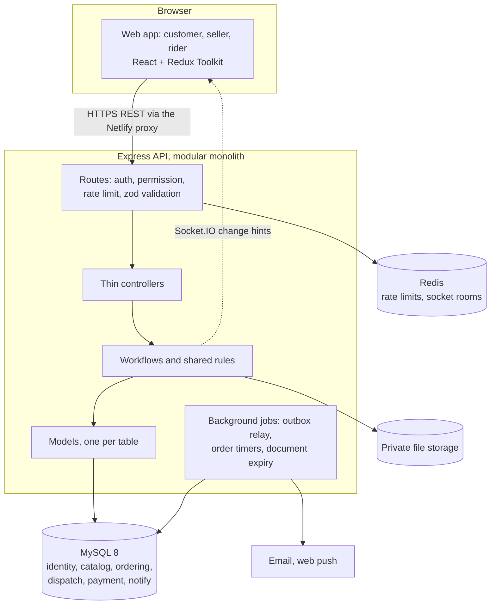

# SnackHub

**Hyperlocal delivery for India's regional snacks, from verified shops, street stalls and home kitchens near you.**

[](https://github.com/Syama-202/SnackHub/actions/workflows/ci.yml)


**Live demo:** https://snackhub-india.netlify.app

> All shops, people, prices and pictures in this project are demo data. The demo runs on free
> hosting, so the first request after a quiet spell can take up to a minute while the API wakes.

---

## Contents

- [Overview](#overview)
- [Features](#features)
- [Tech stack](#tech-stack)
- [Architecture](#architecture)
- [How the hard parts work](#how-the-hard-parts-work)
- [Project structure](#project-structure)
- [Getting started](#getting-started)
- [Running tests](#running-tests)
- [Scripts](#scripts)
- [API documentation](#api-documentation)
- [Deployment](#deployment)
- [Roadmap](#roadmap)

---

## Overview

Small makers of regional snacks, from Guntur's mirchi bajji to Kakinada's kaja, are mostly
missing from the big delivery apps, and their food has real constraints: some snacks must
arrive hot, others travel well. SnackHub is a marketplace built around those constraints.

- **Customers** order from shops that can actually reach their address in time, see an honest
  delivery window, and track the rider live.
- **Sellers** are verified (food licence and documents) before they can list anything, then
  manage products, stock and incoming orders from their own console.
- **Riders** are verified too, receive delivery offers near them, and hand over each order with
  a one-time code from the customer.

Hot snacks get a shorter range and ride-time cap than sweets and dry snacks, and every delivery
promise is calculated from distance, preparation time and riding speed rather than guessed.

## Features

### For customers
- Browse shops and snacks that can deliver to the chosen address, by category, region or mood
- One-shop cart with server-side pricing, and checkout with pay on delivery
- Live order tracking on a map, with status updates as they happen
- A 4-digit delivery code that appears only when the rider is close
- Saved addresses, favourites, "order again", in-app notifications and web push
- Report a problem after delivery, with photos; simple cases are resolved automatically with app credit
- Sign in with email and password or Google, with optional two-step sign-in

### For sellers
- Guided onboarding with document upload; documents asked for depend on the business type
- Products with stock adjustments (plus or minus, with a reason) that never overwrite a sale in progress
- Live order board: accept within 2 minutes, pack, and see when a rider is on the way
- Opening hours, holidays, busy mode, and payout statements

### For riders
- Onboarding with vehicle-specific documents
- Delivery offers with a 20-second timer, pickup, live GPS sharing and handover with the customer's code
- Earnings, cash-on-delivery balance and pay disputes

### Platform
- Every order status change follows one shared state machine with a single owner per step
- Real-time updates over Socket.IO, with polling as a safety net
- Notifications by in-app inbox, email and web push, delivered reliably through a transactional outbox
- Automatic timers: unaccepted orders are cancelled and their stock returned, unanswered offers move to the next rider
- An internal staff console (a separate, private build) for verification, live operations and support

## Tech stack

| Layer | Technology |
| --- | --- |
| Front end | React 19, Redux Toolkit, React Router, react-hook-form, Tailwind CSS v4, Vite, MapLibre GL, Motion |
| Back end | Node.js, Express, Knex, zod, Socket.IO, pino |
| Data | MySQL 8 (six schemas), Redis |
| Auth and security | Argon2id, JWT access tokens, rotating refresh cookies, TOTP (otplib), Google Identity, helmet |
| Files and messages | S3-compatible private storage, nodemailer, Web Push |
| Testing | Vitest, Supertest, GitHub Actions |
| Hosting | Netlify (sites), Render (API), Aiven (MySQL), Upstash (Redis), Backblaze B2 (files) |

## Architecture

SnackHub is a **modular monolith**: one Express API, split into six modules that each own their
own MySQL schema and their own database user. A module can only reach its own tables, so the
boundaries are enforced by the database rather than by convention, and any module could later
be moved into a service of its own.



| Module | Owns |
| --- | --- |
| `identity` | Accounts, roles, passwords, sessions, two-step sign-in, addresses, audit log |
| `catalog` | Shops, products, stock and stock holds, the shared snack catalogue |
| `ordering` | Carts, orders and their history, delivery policy, complaints, credits |
| `dispatch` | Riders, delivery offers and assignments, GPS trail, earnings, cash |
| `payment` | Payments, refunds and an append-only ledger |
| `notify` | In-app notifications and push subscriptions |

Business rules that both the front end and the back end need (order states, money, password
rules, permissions, distance) live in `shared/domain`, so the two never disagree.

## How the hard parts work

**Checkout that survives retries and races.** Every checkout carries an `Idempotency-Key`. The
server derives the order's key from it, so a double tap or a network retry returns the same
order instead of creating a second one. Prices and delivery fees are always recomputed on the
server. Stock is taken with a single conditional update (`qty = qty - n WHERE qty >= n`), in
product-id order so two checkouts never lock rows in opposite orders; when two people race for
the last unit, exactly one wins.

**Consistency across modules.** Stock and orders live in different schemas, so checkout holds
the stock first, then creates the order, then confirms the hold. If anything fails in between,
the hold is released, and a timer recovers any hold left behind by a crash.

**One owner per status change.** Order states (`PLACED`, `ACCEPTED`, `PACKING`, `PACKED`,
`PICKED_UP`, `ON_THE_WAY`, `ARRIVED`, `DELIVERED`, plus `CANCELLED` and `REJECTED`) can only
change through `canTransition(from, to, role)`, and every change is a compare-and-set
(`... WHERE status = :from`), so two people acting at once cannot both succeed.

**Reliable notifications.** A change that must notify someone writes an outbox row in the same
transaction. A relay claims rows with `FOR UPDATE SKIP LOCKED`, sends them, and retries failures
with exponential backoff, so nothing is sent for a change that rolled back and nothing is lost
in a crash.

**Secure sessions.** Passwords are hashed with Argon2id. Access tokens are 15-minute JWTs kept
in memory; the refresh token is an `httpOnly`, `SameSite=Strict` cookie stored only as a hash
and replaced on every use. If an old refresh token is ever used again, every session from that
sign-in ends. Sellers must use an authenticator app; customers and riders may.

**Private delivery code.** The 4-digit code is never stored: it is derived from the order with a
server key, shown to the customer only once the rider is within 500 m, and locked after three
wrong tries.

**Real-time without leaking data.** Socket events are hints such as "order 42 changed"; the app
then reads the update over the normal API, which checks permissions. Rooms are assigned from the
signed token, so a client cannot listen to someone else's order.

**Rate limits.** Every route has its own limit, counted in Redis with an atomic Lua script so all
API processes share it. If Redis is unavailable, counting continues in memory instead of
switching the limits off.

## Project structure

```
SnackHub/
|-- frontend/            React app (customer, seller, rider) and the staff console build
|   `-- src/
|       |-- pages/       Screens by role: customer/, seller/, rider/, auth/, common/
|       |-- components/  ui/ (shared primitives), layout/, cart/, product/, tracking/, ...
|       |-- store/       Redux store and slices
|       |-- services/    API client and real-time socket
|       |-- hooks/       Polling, real-time, motion and catalog hooks
|       `-- mocks/       In-browser mock API for the one-tap demo
|-- backend/             Express API
|   |-- src/
|   |   |-- config/      Settings validated at start-up, database options
|   |   |-- db/          Connections, migrations, demo seed
|   |   |-- models/      One file per table, grouped by module
|   |   |-- controllers/ Request handlers, one file per area
|   |   |-- routes/      Endpoints with their middleware and zod schemas
|   |   |-- middleware/  Auth, permissions, rate limits, uploads, errors
|   |   |-- utils/       Workflows (orders, dispatch, payments) and helpers
|   |   `-- jobs/        Outbox relay, order timers, expiry and clean-up
|   `-- tests/           Integration tests against MySQL
|-- shared/              Business rules and demo seed data used by both sides
|-- infra/               Docker Compose for local MySQL, Redis and Mailpit
`-- scripts/             Setup and local development helpers
```

## Getting started

### Prerequisites

- **Node.js 20.6 or newer**
- **MySQL 8**, either installed locally or through Docker
- **Docker** (optional) for Redis; without it, rate limits and live updates still work within a single process

### 1. Clone and install

```bash
git clone https://github.com/Syama-202/SnackHub.git
cd SnackHub
npm --prefix backend install
npm --prefix frontend install
```

### 2. Create the local settings

```bash
npm run setup
```

This creates `backend/.env` and `infra/.env` with random local passwords and secrets. It never
prints a secret and never overwrites a file that already exists. Both files are ignored by git.

### 3. Create the database

Choose one.

**A. MySQL installed on your machine (port 3306)**

```bash
npm run db:local
```

It asks once for your MySQL root password (never stored), then creates the six schemas, one
user per module with access to its own schema only, and a migrator user. It also points
`backend/.env` at your local server.

**B. MySQL in Docker (port 3307)**

```bash
npm run db:up
```

Starts MySQL, Redis and Mailpit. The schemas and users are created on the first start.

### 4. Create the tables and load demo data

```bash
npm run migrate
```

```bash
npm run seed
```

Both are safe to run again; the seed always produces the same demo data.

### 5. Start Redis (optional)

```bash
npm run redis:up
```

Runs SnackHub's own Redis on `127.0.0.1:6380`, so it never clashes with another project on 6379.

### 6. Run the app

```bash
npm run dev
```

This starts Redis (if Docker is running), then the API, and the web app once the API is ready,
all in one terminal. Or run them separately:

```bash
npm run dev:backend
```

```bash
npm run dev:frontend
```

| What | Address |
| --- | --- |
| Web app | http://localhost:5180 |
| API | http://localhost:4000 (health check at `/health`, readiness at `/ready`) |
| API documentation | http://localhost:4000/api/docs |

### 7. Try it

- **Fastest:** every sign-in page has a one-tap **demo account** (customer, seller and rider).
  The demo runs on an in-browser mock, so it works even without the database.
- **Real accounts:** sign up at `/customer/signup`, `/seller/signup` or `/rider/signup`. New
  accounts confirm their email first. In development no email is sent: each message is saved
  as an `.eml` file in `backend/storage/mail` (open it in any mail app or text editor to click
  the link). With the Docker setup you can also point SMTP at Mailpit and read mail at
  http://localhost:8025.

### Optional configuration

All settings are documented in `backend/.env.example` and `frontend/.env.example`. The API
checks every setting at start-up and stops with the name of anything missing or invalid.

- **Google sign-in:** create an OAuth **Web client ID** in Google Cloud (authorised JavaScript
  origin `http://localhost:5180`), then set `GOOGLE_CLIENT_ID` in `backend/.env` and
  `VITE_GOOGLE_CLIENT_ID` in `frontend/.env.local` (copy `frontend/.env.example`). No client
  secret is needed.
- **Email:** set the `SMTP_*` values in `backend/.env` to send real email.
- **Web push:** run `npx web-push generate-vapid-keys` and set `VAPID_PUBLIC_KEY` and
  `VAPID_PRIVATE_KEY`.
- **File storage:** uploads are stored on disk in `backend/storage/private` by default; set
  `STORAGE_DRIVER=s3` and the `S3_*` values to use an S3-compatible bucket.

Restart the API and the web app after changing a settings file.

## Running tests

```bash
npm test
```

The back-end suite runs against the real MySQL database from the setup above, using Vitest and
Supertest. Each test runs inside database transactions that are rolled back afterwards, so your
local data is never changed. The tests cover accounts and sessions, two-step sign-in, roles and
permissions, onboarding and uploads, the full order flow, payments, complaints, live updates,
rate limits and database constraints, including races such as two customers buying the last
unit at the same moment.

GitHub Actions runs the same suite on every push and pull request against a MySQL 8.4 service,
and builds the front end.

## Scripts

Run from the repository root.

| Command | Description |
| --- | --- |
| `npm run setup` | Create the local settings files |
| `npm run db:local` | Create the schemas and users on a locally installed MySQL |
| `npm run db:up` / `npm run db:down` | Start or stop MySQL, Redis and Mailpit in Docker |
| `npm run redis:up` / `npm run redis:down` | Start or stop only Redis |
| `npm run migrate` | Apply all database migrations |
| `npm run migrate:status` | Show applied and pending migrations |
| `npm run migrate:down` | Undo all migrations |
| `npm run seed` | Load the demo data |
| `npm run dev` | Run Redis, the API and the web app together |
| `npm run dev:backend` | Run the API on port 4000 |
| `npm run dev:frontend` | Run the web app on port 5180 |
| `npm test` | Run the back-end test suite |
| `npm run build` | Build the front end for production |
| `npm run jobs` | Run the background jobs once (for an external scheduler) |

## API documentation

The API is versioned under `/api/v1`. With the API running, open
http://localhost:4000/api/docs for Swagger UI, or fetch the OpenAPI 3.1 document from
`/api/v1/openapi.json`. The documentation is generated from the same zod schemas that validate
each request, so it always matches the code. Errors have one shape:

```json
{ "error": { "code": "OUT_OF_STOCK", "message": "Only 2 Mirchi Bajji left", "requestId": "..." } }
```

## Deployment

| Part | Platform |
| --- | --- |
| Web app | Netlify, with a strict Content Security Policy and HSTS |
| API, real-time and background jobs | Render (Docker image from `backend/Dockerfile`, blueprint in `render.yaml`) |
| MySQL 8 | Aiven, over TLS |
| Redis | Upstash, over TLS |
| Uploaded documents | Backblaze B2, a private S3-compatible bucket |

The web app forwards `/api/*` to the API through Netlify's signed proxy, so the browser only ever
talks to its own site and the API can trust the visitor's real IP address for rate limiting.
Secrets are kept only in each platform's environment settings, never in the repository.

## Roadmap

- Online payments in test mode (the payment flow is built behind a provider interface; pay on
  delivery is live today)
- End-to-end browser tests and load testing
- A separate worker process for background jobs
- Virus scanning for uploaded documents in production
